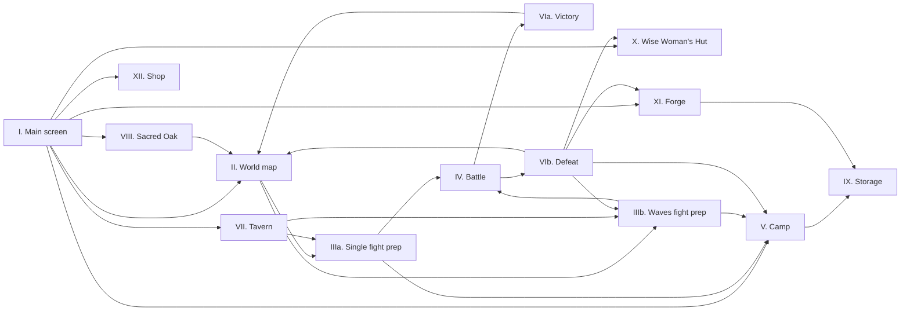

# Screen flow

The wireframes of the MVP screens live in Figma, with a clickable prototype ("Featherguard wireframe"):
https://www.figma.com/design/ZBaApLvcz7Z4QaCam4z4jc/Untitled--Copy-?node-id=0-1

The wireframes show layout and flow only. Game rules live in [`GDD.md`](../GDD.md); where a wireframe shows a placeholder value or a proposal, the GDD lists it as an open question.

## Screens

| # | Screen | Purpose |
|---|---|---|
| I | Main screen (Stronghold) | Buildings, Camp, settings and **Embark** |
| II | World map | Pick a land and an activity |
| IIIa | Single fight preparation | Difficulty, rewards, party and potions before a single fight |
| IIIb | Waves fight preparation | The same for a waves fight, with the number of waves |
| IV | Battle | Combat HUD, timing, Rage, Law and statuses |
| V | Camp | Pick the party; hero details, Storage and potions |
| VIa / VIb | Battle result | Victory with rewards and EXP, or defeat |
| VII | Tavern | Entrances to Endless Run and Arena |
| VIII | Sacred Oak | Story missions; the bestiary after the MVP |
| IX | Storage | All equipment; a separate tab for materials |
| X | Wise Woman's Hut | Brewing potions |
| XI | Forge | Forging equipment and the forging minigame |
| XII | Shop | The merchant's 3 offers |

Windows over a screen: Hero details, Slot items, Potions, Salvage, Forging minigame and Settings.

## Flow

**Back** returns to the screen the player came from (the main screen, the world map or the Camp). Settings opens as a window from most screens.
